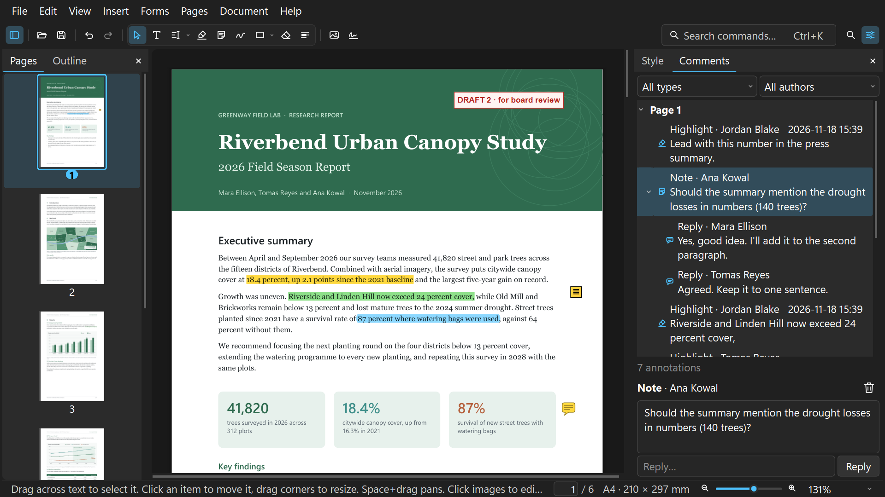
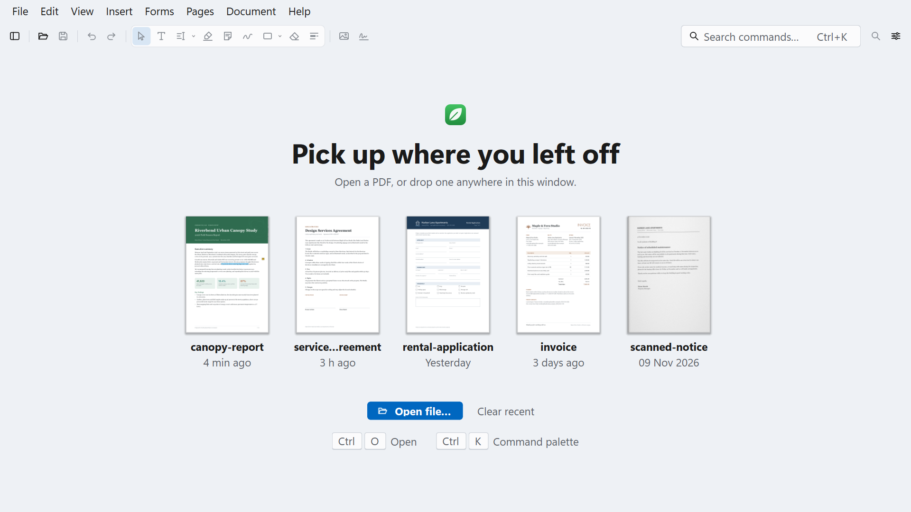

# Leaf

A fast, local PDF editor. Qt 6 UI in a Windows 11 (Fluent) style, light and dark, with your accent color (follows the system on Windows 11, KDE and GNOME; high-contrast themes keep the system look), MuPDF engine. Nothing leaves your machine.





Downloads: [Releases](https://github.com/jagritvats/Leaf-PDF-Viewer/releases). Contributing: [CONTRIBUTING.md](CONTRIBUTING.md).

## Run

```sh
uv sync
uv run leaf-gui path/to/file.pdf   # no console window
uv run leaf path/to/file.pdf       # with console (see errors)
uv run leaf text file.pdf           # command line, no window: `uv run leaf-cli --help`, docs/edit-set.md
```

Tests (headless): `QT_QPA_PLATFORM=offscreen uv run pytest -q`

## Build (packaged app)

Every packaged build checks itself with `--self-test`: open, render in the worker process, edit, save, reopen, all
features installed, digital signature (sign + verify), Reduce file size in its worker process, and OCR in its worker
process when the build has an engine. Details, sizes and per-platform status: [packaging/PLATFORMS.md](packaging/PLATFORMS.md).

| Platform | How | Output | Status |
|---|---|---|---|
| Windows | `uv sync --group build` · `uv run python packaging/make_icons.py` · `uv run pyinstaller --noconfirm packaging/leaf.spec` · optional installer: `iscc packaging\leaf.iss` (Inno Setup 6.3+) | `dist/Leaf/Leaf.exe` (126 MB, zip 57 MB), `Leaf-<v>-windows-x64-setup.exe` | verified locally (installer: CI) |
| Linux | `bash packaging/build_linux.sh` (on Linux or WSL; build on the oldest distro you target, glibc 2.34+) | `dist/leaf-<v>-linux-x86_64.tar.gz`, AppImage if `appimagetool` is available | verified in WSL (tarball 90 MB, AppImage 84 MB) |
| macOS | needs a Mac: the GitHub Actions workflow (`.github/workflows/build.yml`) builds it on `macos-14` | `Leaf-<v>-macos-arm64.dmg` (ad-hoc signed, macOS 14+) | prepared (CI) |

**OCR variant:** set `LEAF_BUNDLE_OCR=1` (with the `ocr` extra installed) to bundle RapidOCR + ONNX Runtime + OpenCV,
e.g. `LEAF_BUNDLE_OCR=1 uv run pyinstaller --noconfirm --distpath dist/ocr --workpath build/ocr packaging/leaf.spec`
(Windows: 335 MB, zip 150 MB). The standard build leaves the OCR stack out and recognizes text out of the box
with MuPDF's built-in Tesseract and the bundled English data (`leaf/data/tessdata`, tessdata_fast, ~4 MB).

CI builds and self-tests all three on every push; pushing a `v*` tag (or running the workflow manually) also builds
the OCR variants, and a tag drafts a GitHub release with the files. Unsigned builds trigger SmartScreen (Windows) and
Gatekeeper (macOS: right-click › Open) warnings until you add code signing (Windows certificate; Apple Developer ID +
notarization). Leaf is AGPL-3.0, like MuPDF: anyone distributing a build must offer the matching source.

## What it does

| Area | Features |
|---|---|
| View | Continuous, single-page and two-page (book) layouts; Ctrl+wheel/pinch zoom at cursor; fit width/page; sharp tiles at any zoom; search (Ctrl+F); text selection + copy; clickable links with back/forward (Alt+←/→); outline panel (F8); night mode; Focus mode (Ctrl+Shift+F: just the page, a floating toolbar and page/zoom bar that slide away while you read; Alt or F10 shows the menus, Esc leaves); full screen (F11) and presentation (F5); start screen with your recent files as page covers; reopens each file where you left off |
| Annotate | Formatted text boxes (any installed font, embedded as a subset; bold/italic/underline/strike, alignment, line spacing, fill, border; any Unicode script), highlight text, sticky notes, freehand, rectangle, ellipse, line, arrow, whiteout, images; floating mini-toolbar on the selection; duplicate (Ctrl+D) |
| Existing annotations | Annotations already in the file (from any app) can be selected, moved, restyled and deleted; untouched ones are saved byte-for-byte. Comments panel (F9) with threads, filters, inline editing and replies |
| Forms | Fill text (multi-line, comb, max length, auto size), checkbox, radio, dropdown, list box; read-only and password fields; Tab follows document order; required fields marked; sign signature fields; reset/clear; **create new fields**; export/import data (JSON, XFDF); save a flattened copy |
| Sign | Draw, type or import a signature (background auto-removed); saved to a reusable library. **Digital signatures** (PAdES B-B, or B-T with a timestamp server you configure): your .p12/.pfx or a self-signed certificate created in Leaf; visible (in a field or a box you place, with your handwritten signature) or invisible; certify (no changes / form filling / comments). Signatures panel (F12) and banner: integrity, changes after signing, trust (your trusted certificates + the system store), timestamp; checked offline, off the UI thread |
| Pages | Multi-select and block drag-reorder in the sidebar; full-window organizer (Ctrl+Shift+O); rotate, delete, duplicate, reverse, move to start/end; insert blank or from file; copy/cut/paste pages between windows; paste an image as a page; extract by range ("1-3, 7, 10-") or one file per page; split every N pages; **crop** with a crop tool (`C`, drag a rectangle → this/selected/all/odd/even pages), by margins (pt/mm/in) or auto-crop whitespace; remove crop |
| Document | Watermark (text/image, behind or in front), header & footer with {page}/{pages}/{date}/{filename}/{title}, Bates numbering — live preview, applied in final page order; properties (title, author, subject, keywords, fonts); password protection (AES-256) with permissions; **reduce file size** (Lossless/Print/eBook/Screen/Custom presets, size breakdown, writes a separate optimized copy, keeps encryption) |
| OCR | Document › Recognize text (OCR)…: scanned pages become searchable and selectable (find bar, select/copy work right away; an invisible text layer is written on save, incrementally when possible). Runs in a separate process with per-page progress and cancel; undoable; offers itself when a document looks scanned; View › Show recognized text tints words by confidence. Engines: Tesseract via MuPDF, English built in (works out of the box); RapidOCR (optional `ocr` extra: Latin-script languages, Chinese, Japanese). Pick a language and Leaf uses the best engine installed for it (or the one you chose, remembered). *Add languages…* downloads Tesseract language files (tessdata_fast: Hindi, Arabic, Cyrillic, CJK, Indic scripts, … — `eng+hin` combinations) on request with progress/cancel; only the language data is downloaded, documents never leave the machine |
| Redact | Redact tool (`X`): drag across text (word-snapped) or draw a box; Edit › Redact selected text; Search & redact (text, email, phone, card numbers, IBAN, dates, custom regex) with a reviewable hit list; Redactions panel (go to, remove, overlay text). At save the text, image pixels, vector graphics, annotations, form fields and links under each mark are removed (MuPDF `apply_redactions`, always a full rewrite with `garbage=4`), with a warning that names signatures it will break. Sanitize document: metadata/XMP, JavaScript and actions, attachments, comments, hidden text, hidden layers, flatten forms, links, thumbnails, page labels |
| Edit text | Edit text tool (`I`): hover outlines the line (or paragraph — Tab toggles), click to edit in place in the original font, size, color and angle; Enter applies, Esc cancels. Rewrites the original glyphs with the PDF's own embedded font (no-op edits are pixel-identical across base-14, embedded/subset TrueType, CFF, Type3, CJK, kerning, rotated text); characters the font lacks fall back per glyph to a matching subset font. Refuses with a reason when it can't be faithful (no reliable Unicode, Indic/Arabic/Hebrew/Thai shaping, vertical writing, OCR or outlined text). Saves rewrite the file so the old text is really gone |
| Images | Images already in the page: with the Select tool click one (Alt+click: also page-sized backgrounds/scans, or under text) to move, resize (Shift: free aspect), rotate 90°, replace with a file (keeps its place), delete, save as original/PNG/JPEG or copy; right-click or Edit › Image. Changes exactly that draw (other uses of the same image object stay), keeps its place in the paint order; inline images refused |
| Find & replace | Edit › Replace… (Ctrl+H): a replace row under the find bar; match case, whole word, regular expressions with groups (`\1` or `$1`), on the find bar too. Matches the text as shown (earlier edits included); every replacement is an edit of the line that holds it (all hits of a line in one edit, an edited line or paragraph gets its current text with the hits replaced). Replace one or Replace all (one undo step; scans in the background with progress and cancel — cancel changes nothing). Lines the text editor can't change faithfully and matches that run across lines are skipped and listed with the reason, jump-to and aggregated font warnings. Optionally also in text boxes and form fields |
| Print | Print and preview (Ctrl+P): ranges, copies, fit/actual size, auto-rotate, grayscale; prints exactly what Save would write |
| Export | File › Export: pages as images (PNG, JPEG, WebP/TIFF when Qt can write them; dpi, range, one file per page), all images (each image object once, original format), text (reading order) or Markdown (headings from font sizes); from what Save would write, with progress and Cancel |
| Commands | Command palette (Ctrl+K); every shortcut rebindable (Edit › Keyboard shortcuts), with conflict detection; generated cheat sheet (F1 or `?`) |
| Settings | Edit › Settings… (Ctrl+,): searchable pages for General (author name, units, recent files, reopen position), Appearance (system/light/dark theme, night mode, thumbnails, toolbar labels), Editing (default text font/size, arrow-key step, confirm page deletion), Saving (crash-recovery interval or off, always rewrite the whole file, keep `file.pdf.bak`), Performance, OCR, Signing, Privacy, Keyboard; changes apply right away. A short skippable welcome tour on first launch, one-time tips (Help › Show tips again) and hints in empty panels |
| Links, bookmarks, attachments | Link tool (`K`: drag a rectangle; click a link to select, double-click/Enter to edit, Delete to remove; every link outlined while it's active) and Insert › Link… (Ctrl+L, one link per selected line): web address, page in this document (top or a spot picked on the page), email, file. Page targets follow reordering and are written at the final page numbers. Bookmarks: Add bookmark (Ctrl+Shift+B, title from the selected text or the nearest heading), rename (F2), delete, drag to reorder/nest, Move in/out, set destination to the current view; an untouched outline is saved exactly as it was. Attachments panel (Shift+F8): embedded files and file-attachment comments: open (asks first for programs), save as, add (or drop files), rename/describe, remove. All undoable |
| Compare | Document › Compare with › Another PDF… / Saved version (review unsaved changes): side by side with synced scroll and zoom, pages aligned by text similarity (inserted/deleted pages leave a gap), word-level changes highlighted (red old, green new), graphics/image changes from a pixel diff, Overlay mode (changed pixels in magenta), change list with summary counts; next/previous change Alt+Down / Alt+Up; computed in small steps so big documents stay responsive |
| Accessibility | Screen-reader names on controls (dialogs included), "Page N of M" announced with the page's text as description, Tab order toolbar → Pages → page → panels, visible focus on swatches and thumbnails, high-contrast themes respected; translations groundwork ([docs/translating.md](docs/translating.md)) |
| Safety | Unlimited undo/redo with a History panel (F7); atomic save (temp file, verified, then renamed); incremental save when pages are unchanged so existing digital signatures stay valid; crash recovery copies of unsaved work |
| AI agents | `leaf mcp`: an MCP server (stdio) for Claude Desktop, Claude Code and other agents: read text/boxes, fields, find, and write NEW files (edits applied, OCR, redactions with `confirm`, text export), never overwriting. Live agent link (off by default, Settings › Agents, token file only you can read): agents list and read open documents and *propose* edits, which you review in the Agent suggestions panel (Accept / Reject / Accept all, one undo step "Agent: …"); agents can never save or sign. Single instance: `leaf file.pdf` hands files to the running Leaf. See [docs/agents.md](docs/agents.md) |

Single-key tools when the page has focus: `V` select, `T` text, `H` highlight, `D` draw, `R` rect, `E` ellipse, `L` line, `A` arrow, `W` whiteout, `X` redact, `N` note. Space+drag pans.

## How it's built

```
leaf/
  document.py       pristine sources (opened from bytes, never mutated) + page list + form values; save pipeline
  canvas.py         QGraphicsView: page items, prioritized renderer (visible pages first, memory budget), tools, links, layouts
  render_worker.py  out-of-process renderer so heavy pages never block the UI
  items.py          overlay items; each knows how to write itself into a PDF page (apply)
  forms.py          form fields as lightweight scene items (crisp at any zoom)
  fields.py         form authoring: new fields are overlays that become real widgets on save
  commands.py       QUndoCommands
  pageops.py        page-list operations, page ranges, cross-window page clipboard
  crop.py           page crop model (PageRef.crop, page.rect space), margins/auto-crop helpers, CropBox at save
  optimize.py       Reduce file size: presets, size breakdown, optimizer (runs in a worker process; Qt-free)
  ocr.py, ocr_worker.py   OCR engines (lazy), engine choice per language, scanned-page detection, invisible text layer at save; recognition process (Qt-free)
  ocrdata.py        Tesseract language data: bundled eng (source tree / sys._MEIPASS), language list, HTTPS downloads to AppLocalDataLocation/tessdata (atomic, size + header checks)
  textedit.py       edit the page's own text (Qt-free engine): finds lines/paragraphs, removes exactly their glyphs with MuPDF's content filter, re-writes the new text with the ORIGINAL font objects (subset fallback fonts for missing glyphs); replayed at save (after form values, before overlays) and on a per-page "slot" of the display copy that screen, thumbnails, search and selection use
  images.py         edit the page's own images (Qt-free engine): finds every image draw with MuPDF's sanitize filter (image callback), removes one draw or swaps it for a placeholder that becomes `q cm /Im Do Q` reusing the same xref; replayed at save right after text edits and in the same display slot
  export.py         File › Export: snapshot via the save pipeline, then pages/images/text/Markdown exporters as resumable steps
  cli.py, editset.py   command line (`leaf <command>`, headless, same engine) and edit sets (versioned JSON of changes: export, validate, apply as one undo step; docs/edit-set.md); UI in features/editset.py
  replace.py        Find & replace core (Qt-free): matching over the shown text unit by unit, hits -> one text edit per line, checks and the summary; UI in features/replace.py
  annots.py         adopts existing annotations as editable items; hidden in a display-only copy once changed
  comments.py       comments panel
  fonts.py, richtext.py   system font lookup/embedding; text box formatting -> HTML for insert_htmlbox
  printing.py, docprops.py   print dialog/pipeline; properties, metadata, encryption
  redact.py         redaction marks, save-time removal (redact_page), search & redact, sanitize
  decorations.py    watermarks, headers/footers, Bates numbers: specs, live preview, drawn at save in final page order
  sidebar.py        lazy thumbnails, multi-select, block drag, file drop (also the organizer grid)
  outline.py        bookmarks panel + editing (doc.outline: None = untouched), written with set_toc at final page numbers
  links.py          link model (page targets by uid), Link tool + dialog; save steps for links and the outline/attachments
  attachments.py    embedded files + file-attachment annotations: model, save step, Attachments panel
  palette.py        command palette
  ipc.py            single instance + local server (QLocalServer; Qt-free client): forwards `leaf file.pdf` to the running Leaf
  agentlink.py      live agent link: token file, sessions, list/read/propose; features/agentlink.py: Agent suggestions panel, Settings › Agents
  mcp_server.py     `leaf mcp`: MCP (JSON-RPC 2.0 over stdio) tools, path policy, *_to_copy writers
  settings.py       Settings dialog + `register_page(key, title, factory, order)` for feature pages
  onboarding.py     first-run tour, one-time tips, empty-state hints for panels
  shortcuts.py      shortcut overrides, editor, cheat sheet
  recovery.py       crash recovery
  window.py         menus, toolbar, docks, view stack (welcome / document / organizer), find bar, file handling
  signing.py        digital signatures (pyHanko): identities, signing as an incremental update, verification, trust list
  osint.py          OS integration behind no-op-elsewhere functions: recent documents (Windows jump list), taskbar
                    progress (ITaskbarList3 / Unity LauncherEntry), keep-awake, dark title bar; pen input (pressure,
                    eraser end, barrel-button pan, palm rejection)
  sigpanel.py       Sign dialog, Signatures panel, banner, trusted certificates
  compare.py        Compare documents (Qt-free): page alignment by text similarity, word diff, pixel diff; compare_documents(a, b) -> [Change]; view in features/compare.py
  a11y.py           accessible names for every control, "Page N of M" announcements, Tab order, high contrast, WCAG contrast helpers
  i18n.py           Qt + Leaf translations, tr(), pseudo-locale (LEAF_PSEUDO=1/2); workflow in docs/translating.md
  style/            the look: design tokens (light/dark, accent, type), Fusion + one generated style sheet, panel
                    headers, rounded page view, Windows 11 title bar color; off in high contrast or with LEAF_UI=classic
  welcome.py, toast.py, minibar.py, props.py, signature.py, icons.py   UI pieces
  features/         each area wires itself into the window via install(win): viewing, forms, pages, textfmt, annotations, output, decorate, history
```

The core design decision: **edits are a model, not mutations.** The opened PDF is never modified in memory. Every save
replays the page list, form values and overlays onto a fresh copy. That's why undo survives saves, saving over the
open file works on Windows (nothing is locked), a failed save can't damage the original, and the render worker can
draw the same immutable bytes in another process.

Coordinates: overlays live in the source page's display space (`page.rect`); `apply()` converts with
`page.derotation_matrix`, so pages with their own `/Rotate` and pages rotated in Leaf both come out right (covered by tests).

## Known limits

- Whiteout covers content visually; the text underneath is still in the file. Use Redact (`X`) to remove it.
- Added text and images are flattened into the page on save. Shapes, lines, ink and highlights stay as real PDF annotations, so other viewers can still edit them.
- Page rendering runs in a worker process (toggle in View; set `LEAF_INPROCESS_RENDER=1` to disable). Very large saves still run on the GUI thread.
- Crops are applied as a CropBox (the content outside is hidden, not removed). The crop tool can only shrink a cropped page; use Crop pages… or Remove crop to enlarge it.
- Watermarks/headers already saved into a file can't be removed or edited later in Leaf.
- Editing the page's own text: refused (with the reason) for text without a reliable Unicode mapping, shaped scripts (Arabic, Hebrew, Indic, Thai, …), vertical writing, invisible OCR text, outlined or clipping text, and pages MuPDF's content filter can't reproduce exactly (e.g. outlined text with its own line width). Edited text is drawn after the rest of the page, so copy/paste reading order and tagged-PDF structure don't follow it. Characters the document's font lacks come from an installed font (named in a warning). A save with text edits is a full rewrite (the old text would otherwise stay in the previous revision) unless the file is signed. Duplicating a page brings its original text, not unsaved edits.
- Editing the page's own images: inline images (BI … EI) and draws Leaf can't identify are refused; an image is moved as a box (skew is kept, a clip path around it isn't moved). Images inside Form XObjects are edited on this page's private copy of the form. Exports and "Save image" of a JPEG write the stored bytes; other images become PNG.
- Pen pressure: a stroke is saved as an ink annotation with one (average) width plus an appearance that draws the varying
  width; apps that regenerate annotation appearances (e.g. after moving it there, or in Leaf after you move/restyle it once
  reopened) draw it with the average width. Recent files reach Leaf's taskbar jump list only with the installed app
  (the .pdf registration); a portable run adds them to Windows' Recent files only.
- Copying or duplicating a page brings its original annotations, not unsaved edits to them; thumbnails don't show overlays.
- Links made in Leaf are invisible rectangles (no border), one per selected line; existing links can be retargeted or deleted but not moved or resized. Links and bookmarks whose target page is deleted are left out when saving (a bookmark that still has children stays, without a target). Rename/description edits apply to embedded files, not to file-attachment comments.

## Roadmap

- Done: phase 1 (view, annotate, forms, signatures, pages), phase 2 (redaction, digital signatures, OCR, compression, crop), phase 3 MVP (edit existing text, single lines and paragraphs).
- Next: reading order for edited text (tagged PDF structure), editing Indic/Arabic text (needs shaping-aware re-encoding), Windows certificate store / smart cards for signing, LTV (B-LT) signatures, mobile via a mupdf.js web app (see packaging/PLATFORMS.md).

## License

Leaf is free software under the [GNU Affero General Public License v3.0 or later](LICENSE), the same license as the
MuPDF engine it is built on. The bundled English OCR data is Apache-2.0 ([leaf/data/tessdata](leaf/data/tessdata/README.md)).
